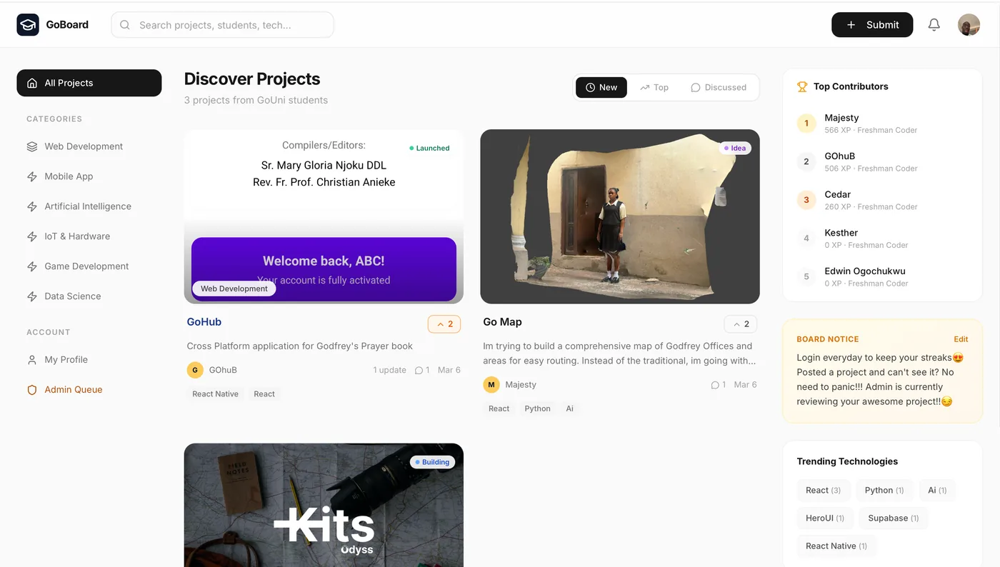

<div align="center">
  

  # GoBoard

  **The premier student project showcase, open-source collaboration network, and gamified builder curriculum for Godfrey Okoye University (GoUni).**

  [](https://react.dev)
  [](https://www.typescriptlang.org)
  [](https://tailwindcss.com)
  [](https://vitejs.dev)
  [](https://firebase.google.com)
  [](https://ai.google.dev)
  [](https://opensource.org/licenses/MIT)

  <br />
  
</div>

---

## 📖 Table of Contents

- [🌟 Overview](#-overview)
- [🚀 Key Features](#-key-features)
  - [1. Verified GitHub Project Showcase](#1-verified-github-project-showcase)
  - [2. Genesis Builder Quests](#2-genesis-builder-quests)
  - [3. Season 1: Prayer Book Redesign Campaign](#3-season-1-prayer-book-redesign-campaign)
  - [4. Open-Source Collaboration & Pull Requests](#4-open-source-collaboration--pull-requests)
  - [5. Discord-Style Student Profiles & Identity](#5-discord-style-student-profiles--identity)
  - [6. Supporters & Stargazers Hub](#6-supporters--stargazers-hub)
  - [7. GoUni Lit Club](#7-gouni-lit-club)
  - [8. Gemini AI Project Analysis](#8-gemini-ai-project-analysis)
  - [9. In-App Knowledge Base (`/docs`)](#9-in-app-knowledge-base-docs)
- [🔒 Security & Anti-Cheat Architecture](#-security--anti-cheat-architecture)
- [🛠️ Tech Stack](#️-tech-stack)
- [📦 Clean Project Structure](#-clean-project-structure)
- [💻 Getting Started](#-getting-started)
  - [Prerequisites](#prerequisites)
  - [Local Installation](#local-installation)
  - [Environment Configuration](#environment-configuration)
  - [Development & Production Build](#development--production-build)
- [📜 License & Credits](#-license--credits)

---

## 🌟 Overview

**GoBoard** is built for student software engineers, designers, and creators across the Faculty of Computing and Information Technology at **Godfrey Okoye University (GoUni)**, Enugu, Nigeria.

Traditional university coursework often remains trapped in local folders or slide decks. GoBoard transforms campus software development into an open, visible, and rewarding culture:
* **Authenticity**: Every software project links directly to a verified public GitHub repository.
* **Collaboration**: Students tag projects as open to pull requests and peer contributions.
* **Gamification**: Transparent XP, streaks, rank progression, and automated GitHub-graded quests encourage consistent coding habits.
* **Recognition**: Campus design campaigns, student ID verification badges, and cash prize payouts reward exceptional engineering and design work.

---

## 🚀 Key Features

### 1. Verified GitHub Project Showcase
* **100% Repository Verification**: Import any public repository directly through GitHub OAuth with instant search and branch detection.
* **Automated README Extraction**: Fetches and parses the repository's `README.md` to extract a clean summary, stripping badges, markdown images, and boilerplate.
* **Live Deployment Detection**: Scans repository metadata, homepage fields, and README links to detect live deployment URLs (e.g. Vercel, Netlify, Render, GitHub Pages, Railway).
* **Automatic Contributor Recognition**: Matches GitHub commit authors to registered GoBoard student profiles.
* **Changelog & Updates**: Authors publish milestone updates and link git commit hashes directly to their project timeline.

### 2. Genesis Builder Quests
A hands-on, automated technical curriculum designed to build student muscle memory in Git and command-line basics:
* **Quest 1: Baby Steps (`+25 XP`)**: Students create their public `GoQuests` repository on GitHub and commit an initialized `README.md` with structured project notes.
* **Quest 2: 0x00. Shell Basics (`+50 XP`)**: Students build bash scripts for current working directory (`pwd`), directory listing (`ls`), and directory creation (`mkdir`) inside a structured directory.
* **Automated Server Grader**: The backend (`api/quest-check.ts`) inspects the student's GitHub repository via the GitHub REST API, verifies file existence, shebang (`#!/bin/bash`), exact line count, and awards XP atomically through a server-authoritative ledger.

### 3. Season 1: Prayer Book Redesign Campaign
* **Campus UI/UX Challenge**: Students submit modern, mobile-friendly interface redesigns for the official GoUni Prayer Book application.
* **Figma & Google Drive Integration**: Zero in-app image uploads required—designers link directly to their interactive Figma prototype or an accessible Google Drive folder.
* **README Pitch Validation**: The server validates that the student's GitHub pitch repository contains at least 80 words detailing the UX problems solved.
* **Fair Voting**: Solo and duo partner submissions with anti-self-voting constraints and admin review queues.

### 4. Open-Source Collaboration & Pull Requests
* **"Open to PRs" Filter**: 1-click filter pill on the feed to discover campus projects actively looking for collaborators.
* **Contribution Area Tags**: Authors indicate exact help needed: `Frontend`, `Backend`, `Mobile`, `UI/UX`, `AI/ML`, `Documentation`, or `Testing`.
* **Live Activity Indicators**: Displays 30-day commit activity, coding streaks, and top language distributions.

### 5. Discord-Style Student Profiles & Identity
* **Custom Banner Studio**: Preset university themes or custom dual-color gradient builder.
* **Student ID Verification**: Verified student badge awarded upon administrative review of physical student ID card uploads.
* **Progression Tiers**: Dynamic rank progression from *Freshman Coder* up to *Distinguished Fellow* based on cumulative XP and project contributions.
* **Wallet & GoCoins**: Student wallet displaying earned GoCoins with direct Nigerian Naira bank transfer payouts.

### 6. Supporters & Stargazers Hub
* **Unified Supporter View**: Accessible directly from any project detail view.
* **GoBoard Upvotes**: View peer students who upvoted the project, including their department, rank, and vote date.
* **GitHub Stars**: Real-time list of GitHub users who starred the repository, with avatars and profile links.
* **Signed-Out State Protection**: Prompts unauthenticated guests to sign in while honoring Firestore access rules.

### 7. GoUni Lit Club
* A creative writing corner for Godfrey Okoye University authors to publish short stories, poetry, and technical essays with community upvotes and discussion.

### 8. Gemini AI Project Analysis
* One-click architectural reviews, real-world impact assessments, and technical upgrade suggestions generated via Google Gemini models (`@google/genai`).

### 9. In-App Knowledge Base (`/docs`)
* Comprehensive documentation covering XP point breakdowns, fair voting guidelines, quest instructions, and collaboration best practices.

---

## 🔒 Security & Anti-Cheat Architecture

* **Server-Authoritative XP Engine (`api/xp-event.ts`)**: XP is granted through an atomic transaction ledger (`api/_lib/ledger.ts`), preventing client-side point manipulation and enforcing daily caps.
* **Production Firestore Security Rules (`firestore.rules`)**:
  - Direct modification of `xp`, `seasonXp`, `goCoins`, and `totalGoCoinsEarned` by clients is restricted.
  - Votes enforce uniqueness (`userId_projectId`) and require signed-in authentication.
  - Self-voting prevention: project authors and duo partners cannot vote on their own entries.
* **7-Day Fair Play Threshold**: Accounts under 7 days old cannot award author XP via votes or comments, mitigating bot farms and spam accounts.
* **Deep Data Sanitization**: Client requests pass through recursive undefined sanitizers to eliminate Firestore write rejections.
* **Native Crypto Auth Verification (`api/_lib/admin.ts`)**: Serverless endpoints cryptographically verify Firebase ID tokens using native Node.js crypto and Google x509 certificates, avoiding CommonJS require issues.

---

## 🛠️ Tech Stack

| Domain | Technology | Description |
|---|---|---|
| **Frontend Framework** | React 19 + TypeScript | Strict mode, functional components, hooks |
| **Styling & Motion** | Tailwind CSS v4 + Framer Motion | Modern utility CSS with spring animations |
| **Icons** | Lucide React | Consistent, lightweight SVG icon system |
| **Routing** | React Router v7 | Client-side routing with lazy loading & Suspense |
| **Backend & Database** | Firebase Authentication + Cloud Firestore | Realtime listeners, secure rules, social auth |
| **Serverless API** | Vercel Serverless Functions (Node.js 22) | Server-authoritative XP, quest checker, AI proxy |
| **AI Inference** | Google GenAI SDK (`@google/genai`) | Gemini models for automated project insights |
| **Build & Bundler** | Vite 6 + PostCSS | Optimized Rollup code splitting & vendor chunks |

---

## 📦 Clean Project Structure

```
goboard/
├── api/                           # Serverless API routes (Vercel)
│   ├── _lib/                      # Shared server utilities
│   │   ├── admin.ts               # Firebase Admin SDK & native crypto JWT verifier
│   │   ├── githubServer.ts        # Server-side GitHub API client
│   │   ├── ledger.ts              # Atomic XP transaction ledger & caps
│   │   └── xpRules.ts             # Canonical XP point constants
│   ├── insight.ts                 # Google Gemini AI project analysis endpoint
│   ├── project-availability.ts    # Unique slug & project title validator
│   ├── quest-check.ts             # Automated Git/Bash quest grader & campaign validator
│   └── xp-event.ts                # Server-authoritative XP grant router
├── components/                    # Modular React components
│   ├── AddUpdateForm.tsx          # Project update & changelog modal
│   ├── AdminQueue.tsx             # Admin review queue for projects & submissions
│   ├── AuthModal.tsx              # Google & GitHub sign-in modal
│   ├── BlurredImage.tsx           # Progressive image loader with blur placeholder
│   ├── Button.tsx                 # Standardized button system
│   ├── CampaignBanner.tsx         # Top banner for active campaigns
│   ├── CampaignHubModal.tsx       # Season 1 Prayer Book Redesign Hub
│   ├── CommentSection.tsx         # Threaded discussion & review component
│   ├── ContributeModal.tsx        # Contributor interest modal
│   ├── ErrorBoundary.tsx          # React error boundary
│   ├── NotificationBell.tsx       # Real-time notification menu
│   ├── NotificationItem.tsx       # Individual notification row
│   ├── ProjectCard.tsx            # Project feed item card
│   ├── ProjectDetailView.tsx      # Comprehensive project showcase view
│   ├── ProjectStargazersModal.tsx # In-app upvotes & GitHub stars list
│   ├── ProjectTimeline.tsx        # Project changelog & commit history
│   ├── PublicProfileModal.tsx     # Student profile modal
│   ├── Skeleton.tsx               # Skeleton loading states
│   ├── SubmitProjectModal.tsx     # 1-click GitHub project submission wizard
│   ├── SubmitWritingModal.tsx     # Lit Club publishing modal
│   ├── ThemeToggle.tsx            # Light/Dark mode switcher
│   ├── Toast.tsx                  # Global toast notifications
│   ├── UserAvatar.tsx             # Standardized user avatar with fallback
│   ├── UserProfile.tsx            # Student profile & settings view
│   ├── WritingCard.tsx            # Lit Club feed card
│   └── WritingDetailView.tsx      # Lit Club reading view
├── contexts/                      # React context providers
│   ├── AuthContext.tsx            # User auth, profile, and GitHub linkage
│   ├── ThemeContext.tsx           # Theme state management
│   └── UserCacheContext.tsx       # In-memory student profile cache
├── customloading/                 # Pre-React initial loading assets
│   └── logo-white-black.png       # Masked loading logo
├── pages/                         # Lazy-loaded page views
│   ├── AdminPage.tsx              # Admin dashboard & moderation
│   ├── DocsPage.tsx               # In-app documentation & rules
│   ├── HomePage.tsx               # Main project feed & filters
│   ├── LandingPage.tsx            # Public landing & onboarding showcase
│   ├── LitClubPage.tsx            # Creative writing collection
│   ├── ProfilePage.tsx            # Student dashboard, wallet, & settings
│   ├── ProjectPage.tsx            # Dedicated project route
│   ├── WelcomePage.tsx            # 5-step onboarding wizard
│   └── WritingPage.tsx            # Dedicated writing route
├── public/                        # Static assets & web-optimized imagery
│   ├── discover.webp              # Platform preview asset
│   ├── leave-updates.webp         # Project updates preview asset
│   ├── llms.txt                   # LLM discoverability index
│   ├── logo.png                   # Official GoBoard brand logo
│   ├── robots.txt                 # Search engine crawler directives
│   ├── sign-in-google.webp        # Auth feature preview asset
│   └── submit-project.webp        # Submission feature preview asset
├── services/                      # Client service layer
│   ├── firebase.ts                # Firebase client SDK initialization
│   ├── firestoreService.ts        # Firestore CRUD queries & data sanitization
│   ├── geminiService.ts           # Client API client for Gemini insights
│   ├── githubService.ts           # Client GitHub API queries & stargazers fetcher
│   ├── utils.ts                   # Formatting, slugs, ranks, and date utilities
│   └── xpClient.ts                # Client router for XP events & quest checks
├── shared/                        # Shared constants & configurations
│   ├── profileOptions.ts          # Department options & academic levels
│   └── questsConfig.ts            # Canonical quest metadata & instructions
├── .env.example                   # Environment variable template
├── .firebaserc                    # Firebase project configuration
├── .gitignore                     # Git ignore rules
├── App.tsx                        # Main shell layout, navbars, and guards
├── cors.json                      # Cloud Storage CORS policy configuration
├── env.d.ts                       # Vite environment type declarations
├── firebase.json                  # Firebase CLI hosting & rules mapping
├── firestore.indexes.json         # Composite Firestore query indexes
├── firestore.rules                # Production Firestore security rules
├── index.css                      # Global Tailwind CSS imports
├── index.html                     # HTML5 entrypoint with pre-React loading screen
├── index.tsx                      # React root application mount
├── package.json                   # Project dependencies and npm scripts
├── router.tsx                     # Declarative React Router configuration
├── tsconfig.json                  # Strict TypeScript compiler options
├── types.ts                       # Core TypeScript type & interface definitions
├── vercel.json                    # Vercel deployment routing & headers
└── vite.config.ts                 # Vite bundler configuration & local API proxies
```

---

## 💻 Getting Started

### Prerequisites
* **Node.js**: `v22.0.0` or higher
* **npm** (`v10+`)
* A Firebase project with **Firestore Database** and **Authentication** (Google & GitHub providers enabled)

### Local Installation

1. **Clone the repository**:
   ```bash
   git clone https://github.com/MajestyChibuikem/goboard.git
   cd goboard
   ```

2. **Install project dependencies**:
   ```bash
   npm install
   ```

3. **Configure environment variables**:
   ```bash
   cp .env.example .env
   ```

4. **Fill in your environment configuration**:
   ```env
   # Google Gemini API (for AI project critiques)
   GEMINI_API_KEY=your_gemini_api_key

   # Firebase Client SDK Configuration
   VITE_FIREBASE_API_KEY=your_firebase_api_key
   VITE_FIREBASE_AUTH_DOMAIN=your_project.firebaseapp.com
   VITE_FIREBASE_PROJECT_ID=your_firebase_project_id
   VITE_FIREBASE_STORAGE_BUCKET=your_project.firebasestorage.app
   VITE_FIREBASE_MESSAGING_SENDER_ID=your_messaging_sender_id
   VITE_FIREBASE_APP_ID=your_firebase_app_id

   # Cloudinary (Direct unsigned image uploads)
   VITE_CLOUDINARY_CLOUD_NAME=your_cloudinary_cloud_name
   VITE_CLOUDINARY_UPLOAD_PRESET=your_upload_preset
   ```

### Development & Production Build

* **Start the development server**:
  ```bash
  npm run dev
  ```
  The app will be available on `http://localhost:3000`.

* **Execute strict type checking and build for production**:
  ```bash
  npm run build
  ```
  Runs `tsc --noEmit` and bundles optimized chunks to the `dist/` directory.

* **Preview the production build locally**:
  ```bash
  npm run preview
  ```

---

## 📜 License & Credits

Distributed under the **MIT License**. See `LICENSE` for details.

Developed with ❤️ for the students and faculty at **Godfrey Okoye University (GoUni)**, Thinkers Corner, Enugu, Nigeria.
