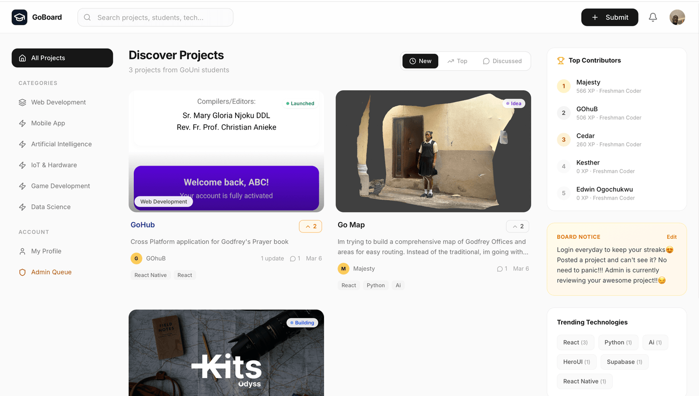

<div align="center">
  

  # GoBoard (GoUni Tech Showcase & Innovation Hub)

  **The premier student project showcase, open-source collaboration network, and academic bounty platform for Godfrey Okoye University.**

  [](https://react.dev)
  [](https://www.typescriptlang.org)
  [](https://tailwindcss.com)
  [](https://vitejs.dev)
  [](https://firebase.google.com)
  [](https://ai.google.dev)
</div>

---

## 🌟 Overview

**GoBoard** is built specifically for students, builders, and creators at **Godfrey Okoye University (GoUni)**. It bridges the gap between campus coursework and real-world software engineering by empowering students to showcase their verified GitHub repositories, collaborate on open-source software, participate in academic bounties, and build a verified developer identity.

---

## 🚀 Key Features

### 1. 🛡️ Verified GitHub-First Project Hub
* **100% Verified Submissions**: Every project is linked to a verified GitHub repository, preventing vaporware and ensuring code authenticity.
* **Full 200+ Repository Catalog**: Live pagination fetches up to 200 repositories directly from the student's GitHub account with instant keyword and language search.
* **Automated README Extraction**: Reads the raw `README.md` to extract a clean, human-readable summary while stripping badges, markdown images, and boilerplate. Seamlessly falls back to repo descriptions when empty.
* **Live Deployment Detection**: Automatically inspects repository homepages and README links to detect and prefill live deployment URLs (e.g. Vercel, Netlify, Render, GitHub Pages, Railway).
* **Automatic Contributor Recognition**: Maps GitHub commit contributors to registered GoBoard student profiles.

### 2. ⚔️ Genesis Builder Quests ("The Basics")
A gamified 4-tier onboarding questline that guides students from their first commit to active open-source contributors:
1. **🛡️ Connect Your Forge**: Link your GitHub profile to unlock your student developer rank and identity badge (`+50 XP`).
2. **🚀 First Ship**: Launch your first project backed by a verified GitHub repository (`+150 XP`, `50 GoCoins`).
3. **🔍 Campus Scout**: Explore peer innovations and upvote at least 3 student projects (`+50 XP`, `20 GoCoins`).
4. **🤝 Open Source Pioneer**: Enable "Open to PRs & Contributions" on your project to invite peer collaboration (`+100 XP`, Contributor Badge).

### 3. 🎯 Season 1 Academic Bounties & Economy
* **Exam Question Paper Bounty**: A crowd-sourced university past question repository where students race for 5 submission slots per course code.
* **Direct Bank Payday System**: Earn GoCoins with zero-minimum payout deposited directly into verified Nigerian student bank accounts.
* **Privacy & Fraud Prevention**: Exam paper scans are strictly private between student and administrators; duplicate submissions are prevented with real-time course slot counters.

### 4. 🤝 Campus Open-Source Collaboration
* **"Open to PRs" Filter**: 1-click filter pill on the discovery feed showing student repositories actively seeking pull requests.
* **Contribution Area Tags**: Filter projects by contribution needs (Frontend, Backend, Mobile, UI/UX, AI/ML, Documentation, Testing).
* **Live GitHub Activity**: Real-time 30-day commit activity tracker, active coding streaks, and primary language distribution.

### 5. 🎨 Discord-Style Student Profiles & Identity
* **Custom Profile Banners**: Choose from preset university themes or build custom dual-color gradients in the Gradient Studio.
* **Student ID Verification**: Verified student badge upon admin verification of physical student ID card scans.
* **Leaderboards & Ranks**: Dynamic progression tiers from *Novice Builder* up to *Distinguished Fellow* based on cumulative XP and contributions.

### 6. 📚 GoUni Lit Club
* A creative writing corner for Godfrey Okoye University writers to publish short stories, poetry, and scholarly essays with community feedback.

### 7. 🤖 Gemini AI Project Analysis
* Instant architectural critiques, real-world impact assessments, and technical upgrade suggestions powered by Google's Gemini models (`@google/genai`).

---

## ⚡ Performance & Optimization Architecture

* **Route-Level Code Splitting**: All pages (`LandingPage`, `HomePage`, `ProfilePage`, `AdminPage`, `ProjectPage`, `LitClubPage`, `WritingPage`) are dynamically loaded via `React.lazy()` and `Suspense`.
* **Granular Vendor Chunking**:
  * `vendor-react`: React 19, React DOM, React Router v7, Scheduler.
  * `vendor-motion`: Framer Motion and animation runtime (`142 kB`).
  * `vendor-icons`: Lucide React icon set (`38 kB`).
  * `vendor-firebase-*`: Independent Firestore, Auth, and Core bundles.
* **Index Bundle**: Main bundle reduced to **~183 kB** (a 68% payload reduction with zero chunk warnings).
* **Scroll Restoration**: Native scroll position memory across project views and feed exploration.

---

## 🛠️ Tech Stack

| Layer | Technology |
|---|---|
| **Frontend Framework** | React 19 + TypeScript (Strict Mode) |
| **Styling & Design** | Tailwind CSS v4, Framer Motion, Lucide Icons |
| **Routing** | React Router DOM v7 (Declarative + Data API) |
| **Database & Auth** | Cloud Firestore, Firebase Authentication, Firebase Storage |
| **Image Hosting** | Cloudinary CDN (Direct unsigned secure uploads) |
| **AI Inference** | Google GenAI SDK (`@google/genai` with Gemini 2.5 Flash) |
| **Build & Bundler** | Vite 6 + PostCSS + Rollup manual chunks |

---

## 📦 Project Structure

```
goboard/
├── api/                       # Serverless API routes (award-xp, etc.)
├── components/                # Modular React components
│   ├── CampaignBanner.tsx     # Quests & Bounty dual-view animated banner
│   ├── CampaignHubModal.tsx   # Interactive Genesis Quests & Slot Tracker Hub
│   ├── SubmitProjectModal.tsx # 1-click GitHub repo importer & validator
│   ├── ProjectCard.tsx        # Project card with open-source badges & stats
│   ├── UserProfile.tsx        # Discord-style profile & wallet management
│   ├── AdminQueue.tsx         # Admin review queue for projects & papers
│   └── ...
├── contexts/                  # AuthContext, UserCacheContext
├── pages/                     # Lazy-loaded route views
│   ├── LandingPage.tsx        # Hero landing page
│   ├── HomePage.tsx           # Discover projects feed & category dropdown
│   ├── ProfilePage.tsx        # Student wallet, badges, and profile
│   ├── ProjectPage.tsx        # Full project detail & updates
│   ├── AdminPage.tsx          # Moderator & verification dashboard
│   ├── LitClubPage.tsx        # Creative writing showcase
│   └── WritingPage.tsx        # Writing view & discussion
├── services/                  # Business logic & external API clients
│   ├── firestoreService.ts    # Firestore queries, transactions & XP limits
│   ├── githubService.ts       # GitHub API, repo search, README parser
│   └── firebase.ts            # Firebase SDK initialization
├── firestore.rules            # Production-grade Firestore security rules
├── router.tsx                 # Lazy routes with Suspense fallbacks
├── vite.config.ts             # Vite configuration with chunk optimization
└── types.ts                   # Central TypeScript interface declarations
```

---

## 💻 Getting Started

### Prerequisites
* **Node.js**: v18.0.0 or higher
* **npm** or **pnpm**
* A Firebase Project with **Firestore** and **Authentication** enabled

### 1. Clone the repository
```bash
git clone https://github.com/MajestyChibuikem/goboard.git
cd goboard
```

### 2. Install dependencies
```bash
npm install
```

### 3. Configure environment variables
Copy `.env.example` to `.env`:
```bash
cp .env.example .env
```

Fill in your configuration keys:
```env
# Google Gemini API
GEMINI_API_KEY=your_gemini_api_key

# Firebase Client SDK Configuration
VITE_FIREBASE_API_KEY=your_firebase_api_key
VITE_FIREBASE_AUTH_DOMAIN=your_project.firebaseapp.com
VITE_FIREBASE_PROJECT_ID=your_project_id
VITE_FIREBASE_STORAGE_BUCKET=your_project.appspot.com
VITE_FIREBASE_MESSAGING_SENDER_ID=your_sender_id
VITE_FIREBASE_APP_ID=your_app_id

# Cloudinary (Image uploads)
VITE_CLOUDINARY_CLOUD_NAME=your_cloudinary_cloud_name
VITE_CLOUDINARY_UPLOAD_PRESET=your_unsigned_preset
```

### 4. Start the development server
```bash
npm run dev
```
The application will launch on `http://localhost:3000`.

### 5. Build for production
```bash
npm run build
```
Runs strict TypeScript checks (`tsc --noEmit`) and compiles the optimized Vite bundle to `dist/`.

---

## 🔒 Security & Firestore Rules

GoBoard enforces strict role-based and rate-limited security rules defined in [`firestore.rules`](firestore.rules):
* **GoCoins Protection**: Clients cannot modify `goCoins` or `totalGoCoinsEarned` directly; rewards can only be granted via admin actions or authorized atomic transactions.
* **XP Bounded Updates**: Client-side XP updates are clamped to `<= 100 XP` per transaction to prevent tampering.
* **Exam Paper Privacy**: Sensitive student uploads remain readable only by the uploader and authorized campus admins.
* **Verification Integrity**: Student verification badges require explicit administrator verification of uploaded student IDs.

---

## 📜 License

Distributed under the **MIT License**. See `LICENSE` for more information.

---

<div align="center">
  <sub>Built with ❤️ by students for students at Godfrey Okoye University, Enugu.</sub>
</div>
