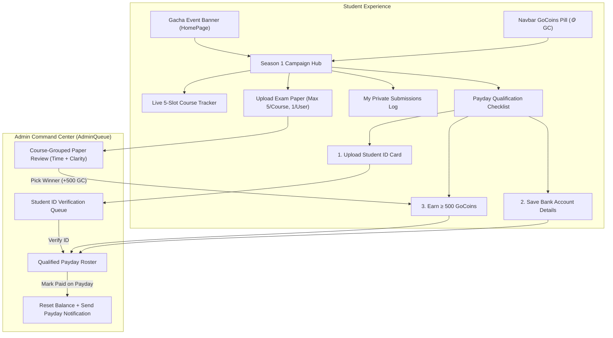

# Season 1 Architecture & Flow Overview: Exam Paper Bounty Campaign

This document captures the system design, user flows, and state machine for Season 1 of GoBoard.

---

## 1. System Architecture

---

## 2. Core Campaign Mechanics

### 5-Slot Course Bounty System
1. **Open Submission**: Any student can type in any course code (e.g. `CSC 301`). Course codes are normalized (e.g. `csc-301` -> `CSC 301`).
2. **5 Slots Max**: Up to 5 submissions are accepted per course code while under review.
3. **1 Per Student**: A student can only upload 1 submission per course code.
4. **Admin Review Criteria**:
   * **Upload timestamp** (speed).
   * **Lighting & readability** (sharpness of paper photos).
5. **Winner Selection**: Admin chooses the best paper:
   * Winner receives **500 GoCoins**.
   * Course status flips to `isCollected: true` (closed to further uploads).
   * Remaining 1–4 submissions for that course are marked `not_selected` with notification.

### Anti-Smurf Student ID Verification
* Students can freely earn GoCoins without upfront barriers.
* To qualify for Payday payout, students must upload their GoUni student ID card.
* Admins verify ID cards in a dedicated verification queue.
* Verified students earn the **Verified GoUni Student** badge on their Discord-style profile.

### Automatic Payday Roster
* No manual withdrawal request queue.
* Admin sets:
  * **Exchange Rate**: Naira value per 500 GoCoins.
  * **Payday Countdown Date**.
* Admin accesses the **Payday Roster**, listing all students where:
  * `verificationStatus == 'verified'`
  * `goCoins > 0`
  * `bankDetails` are complete (Bank Name, Account Name, Account Number).
* Admin completes bank transfer, clicks **Mark Paid**, which deducts the paid GoCoins balance, records the payout history, and notifies the student.

---

## 3. Data Collections

| Collection / Path | Purpose | Visibility |
|---|---|---|
| `examPapers/{paperId}` | Full exam paper submissions (with multi-page photo URLs) | Uploader & Admins only |
| `courseBounties/{courseCode}` | Aggregated slot counters (`submissionCount`, `isCollected`) | All authenticated students |
| `settings/campaignConfig` | Global exchange rate, payday countdown date, campaign active toggle | Public read, Admin write |
| `users/{uid}` | Profile, GoCoins balance, verification status, bank details, Discord styling | Sensitive fields restricted |
